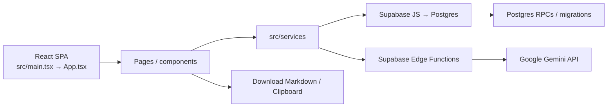
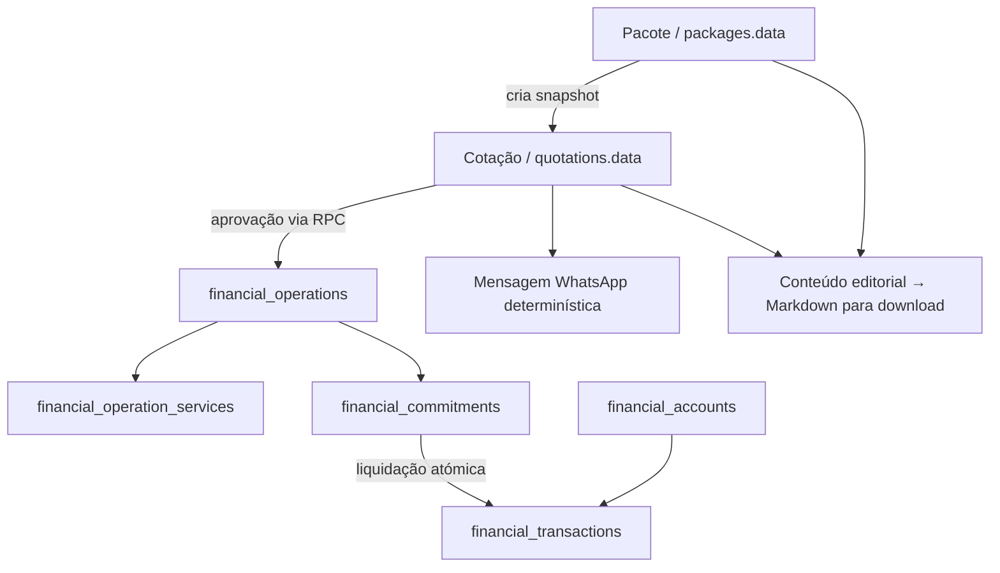

# Arquitetura — Packager (S23)

## Visão geral

**Facto confirmado:** o repositório contém uma SPA React 18/TypeScript, servida por Vite, com rotas de pacotes, cotações e financeiro. O cliente usa Supabase JS para ler/escrever Postgres e invocar Edge Functions. A publicação da aplicação é estática (`dist/`); `wrangler.jsonc` define Cloudflare Pages com fallback SPA.

Não há servidor HTTP próprio no projeto. `supabase/functions/` contém código de backend, mas a configuração/deploy dessas funções no Supabase remoto não foi verificada.

## Entrada, rotas e camadas

- `index.html` fornece `#root`, metadados, fonte Inter e inicialização anti-FOUC do tema.
- `src/main.tsx` monta React Strict Mode, `BrowserRouter` e `App`.
- `src/App.tsx` declara as páginas e inclui `Header` e fallback 404:

| Área | Rotas | Página(s) |
|---|---|---|
| Dashboard | `/` | `src/pages/DashboardPage.tsx` |
| Pacotes | `/pacotes`, `/pacotes/novo`, `/pacotes/:id`, `/pacotes/:id/editar` | `src/pages/packages/` |
| Cotações | `/cotacoes`, `/cotacoes/novo`, `/cotacoes/:id`, `/cotacoes/:id/editar` | `src/pages/quotes/` |
| Financeiro da cotação | `/cotacoes/:id/financeiro` | `src/pages/quotes/QuotationFinancialPage.tsx` |
| Financeiro global | `/financeiro` | `src/pages/financial/FinancialPage.tsx` |
| Catálogo de serviços | `/servicos`, `/servicos/novo`, `/servicos/:id/editar` | `src/pages/services/` |

`src/components/` organiza UI por domínio (`ai`, `common`, `finance`, `import`, `layout`, `packages`, `whatsapp`). `src/types/` contém os contratos TypeScript. CSS é próprio em `src/index.css`; `src/lib/theme.ts` persiste o tema em `localStorage`.

## Serviços e responsabilidades

- `packagesService.ts`, `quotationsService.ts`: CRUD/listagens e ciclo de vida de pacotes/cotações.
- `financeService.ts`: motor puro e determinístico para moeda, custos, preço, lucro e margem. Convenção: `1 EUR = X BRL`.
- `financialService.ts`: persistência financeira, consultas e invocações de RPCs. **Não confundir** com o motor puro acima.
- `favoriteServicesService.ts`, `packageWebsiteContentService.ts`: catálogo reutilizável e conteúdo de website persistido.
- `whatsappService.ts`: gera mensagem comercial a partir da cotação; `WhatsAppMessagePreview.tsx` mostra e copia o texto.
- `contentValidationService.ts`, `aiContentService.ts`: constrói/valida entrada e invoca `generate-content`.
- `markdownService.ts`, `markdownValidationService.ts`: serializa e valida Markdown; o frontend oferece cópia e download. Não foi encontrada publicação automática no Manager/site.
- `imageImportService.ts`: valida ficheiros, converte para Base64, invoca a função de importação e sanitiza o retorno para revisão no formulário.
- `src/services/index.ts` é um barrel parcial; alguns módulos, em particular `financialService`, são importados diretamente.

## Persistência e modelo de dados

As migrations em `supabase/migrations/` definem o schema. Há **25 ficheiros `.sql` locais** neste checkout; o ledger PROD foi alinhado em 2026-10-26 após auditoria manual por catálogo sem Docker. Histórico e limites da comparação estão em `docs/DEVELOPMENT.md`.

- `packages` e `quotations` guardam os dados operacionais em `JSONB`; `quotations.data` é snapshot independente do pacote de origem.
- `favorite_services` fornece dados para preenchimento; o pacote mantém os valores copiados no seu próprio snapshot.
- `package_website_contents` persiste conteúdo de website produzido/editado.
- O módulo financeiro usa tabelas relacionais: `financial_accounts`, `financial_operations`, `financial_operation_services`, `financial_commitments` e `financial_transactions`.

Operações críticas são mantidas no Postgres via RPCs, incluindo aprovação de cotação, liquidação, transferência, ajustes de saldo, cancelamentos, divisão de compromissos e projeções. Exemplos de funções aparecem em `src/services/financialService.ts`; definições e permissões estão nas migrations. Não mover essas regras para o cliente sem revisão de integridade/transação.

## Integrações externas e fluxo de IA

1. O browser valida e envia os dados/imagens através do cliente Supabase.
2. `generate-content` e `import-package-image` estão em `supabase/functions/`; ambas leem `GEMINI_API_KEY` no runtime Deno e chamam Gemini no backend. O navegador não contém chamada direta à API Gemini.
3. `generate-content` solicita conteúdo estruturado e usa pesquisa Google Grounding. `import-package-image` processa até 10 imagens PNG/JPEG por chamada, com limite de 8 MiB por imagem na validação do cliente e limite de Base64 na função.
4. O frontend valida/sanitiza o retorno. O Markdown é gerado deterministicamente no cliente e disponibilizado para cópia ou download; o upload/publicação é manual fora deste repositório.

Outras dependências de browser/rede observáveis: Google Fonts, Clipboard API e download via Blob. Não há integração bancária nem cotação automática de câmbio identificada.

## Invariantes funcionais relevantes

- Cálculo: soma de custos convertidos para a moeda-alvo; conversão EUR↔BRL exige taxa positiva quando necessária. Preço sugerido usa margem padrão de 12%; preço por pessoa divide por adultos + crianças e não inclui bebés. Fonte: `financeService.ts`.
- Conteúdo público: preço comercial vem dos dados financeiros, não pode ser alterado pela IA; validação exige slug em minúsculas/números/hífens, item fixo S23 e observação de pagamento oficial. A sanitização remove notas/dados internos antes da geração. Fonte: `contentValidationService.ts` e `generate-content/index.ts`.
- Markdown: serializador determinístico e validador separados; nome do ficheiro é derivado do slug. Regras de conteúdo público, avisos e proteção de dados internos ficam em `markdownService.ts` e `markdownValidationService.ts`.
- Catálogo de favoritos: pesquisa ativa por nome/localização e desativação por `active`; os pacotes guardam cópias dos dados escolhidos, sem vínculo que altere snapshots existentes. Fonte: `favoriteServicesService.ts` e `PackageFormPage.tsx`.

## Segurança e limites confirmados

- Não há ecrã, provider ou fluxo de autenticação de utilizador nas rotas da SPA. O cliente usa chave pública Supabase (`anon`).
- As migrations iniciais dão políticas `FOR ALL` a `anon`/`authenticated` em tabelas como `packages`, `quotations`, `favorite_services`, `package_website_contents`, `financial_accounts`, `financial_operation_services` e `financial_commitments`. É acesso amplo sem isolamento por utilizador/tenant; confirmar e corrigir a postura de segurança antes de expor a aplicação para além do contexto interno previsto.
- A migration `20261010020000_harden_financial_transactions_and_operations.sql` restringe escrita direta de `anon`/`authenticated` em `financial_operations` e `financial_transactions`; a escrita passa pelas RPCs `SECURITY DEFINER`, várias concedidas também a `anon`.
- **Verificação read-only do PROD em 2026-10-25, revalidada em 2026-10-26:** as nove tabelas `public` da aplicação existem e têm RLS ligado, mas `FORCE ROW LEVEL SECURITY` está desligado. `anon` tem `SELECT` nas nove e privilégios CRUD/policy `ALL USING (true) WITH CHECK (true)` em sete (`packages`, `quotations`, `favorite_services`, `package_website_contents`, `financial_accounts`, `financial_operation_services`, `financial_commitments`). `financial_operations` e `financial_transactions` são somente leitura direta. As 14 funções `SECURITY DEFINER` retornadas pela consulta de catálogo, incluindo RPCs financeiras, indicam `EXECUTE` para `anon`. Não foram consultadas linhas de dados.
- `src/lib/supabase.ts` avisa quando desenvolvimento aponta para PROD e bloqueia em produção origens diferentes da PROD. O aviso em desenvolvimento **não** protege dados. `vite.config.ts` faz validação adicional do ambiente de build.
- As Edge Functions definem CORS `*`; não foi encontrada validação de identidade de utilizador no código dos handlers. O comportamento efetivo do gateway Supabase (incluindo verificação JWT) depende da configuração/deploy e não foi confirmado remotamente.
- O responsável confirmou que autenticação da aplicação será tratada depois de alinhados migrations e deploy. Até essa etapa, o estado atual permanece sem login; não antecipar mudanças em Auth/RLS.
- `backups/*.sql` estão versionados neste checkout. O seu conteúdo não foi lido para evitar expor dados; tratar como material potencialmente sensível e não os copiar para documentação nem para a branch principal sem autorização.

## Configuração e referências

- Cliente/env e guarda de build: `src/lib/supabase.ts`, `src/lib/buildEnvGuard.ts`, `vite.config.ts`, `.env.example`.
- Supabase local: `supabase/config.toml` (Postgres major 17; requer Docker para a stack local).
- Hosting estático: `wrangler.jsonc` aponta para `dist/` e fallback SPA. O responsável confirmou que GitHub está integrado ao Cloudflare Pages e push para `main` publica automaticamente. O repositório tem apenas workflow de backup; build settings e variáveis do Pages não foram observadas.
- Guia visual: `design-system/s23-packager/MASTER.md`.

**Por confirmar:** diff integral via shadow database (não executável sem Docker); configuração/deploy das Edge Functions; desenho futuro do modelo de autenticação; build settings/variáveis reais do Cloudflare Pages. O ledger foi reconciliado por catálogo e o alvo PROD está registado em `docs/DEVELOPMENT.md`.
